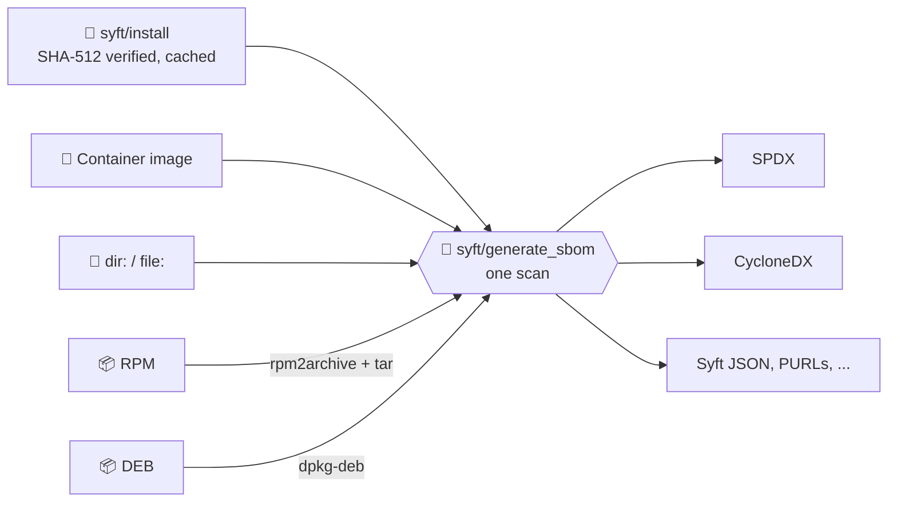

<div align="center">


<h1>Syft Orb for CircleCI</h1>

<p><b>A Software Bill of Materials for every build, in a few lines of YAML.</b></p>

<p>Generate SPDX and CycloneDX SBOMs for container images, source trees, RPMs and DEBs with <a href="https://github.com/anchore/syft">Syft</a>.<br>Checksum-verified installs, caching, and no shell scripts to maintain.</p>

[](https://circleci.com/gh/juburr/syft-orb) [](https://circleci.com/developer/orbs/orb/juburr/syft-orb) [](https://raw.githubusercontent.com/juburr/syft-orb/master/LICENSE) [](https://discuss.circleci.com/c/ecosystem/orbs)

[](#output-formats) [](#supported-platforms) [](#checksum-verification)

<p>
  <a href="#-features"><b>Features</b></a> ·
  <a href="#-quick-start"><b>Quick Start</b></a> ·
  <a href="#-recipes"><b>Recipes</b></a> ·
  <a href="#-orb-reference"><b>Reference</b></a> ·
  <a href="#-info-for-security-teams"><b>Security</b></a> ·
  <a href="https://circleci.com/developer/orbs/orb/juburr/syft-orb"><b>Orb Registry</b></a>
</p>

</div>

<br>

## ✨ Features

<table>
  <tr>
    <td width="33%" valign="top">
      📦 <b>Scan anything</b><br>
      Container images, <code>dir:</code> source trees, single files, image archives, and RPM or DEB packages matched by wildcard.
    </td>
    <td width="33%" valign="top">
      🧾 <b>One scan, many formats</b><br>
      SPDX and CycloneDX out of the box, plus Syft JSON, GitHub JSON, PURLs and more, all from a single Syft run.
    </td>
    <td width="33%" valign="top">
      🔬 <b>Looks inside packages</b><br>
      RPMs and DEBs are unpacked before scanning, so the SBOM lists what actually ships inside them. RPMs over 4 GB work too.
    </td>
  </tr>
  <tr>
    <td width="33%" valign="top">
      🔐 <b>Verified installs</b><br>
      Syft downloads are verified against built-in SHA-512 checksums for 230+ releases, and unknown versions fail closed by default.
    </td>
    <td width="33%" valign="top">
      ⚡ <b>Cached and quick</b><br>
      The Syft binary is cached per version and CPU architecture, so repeat runs skip the download entirely.
    </td>
    <td width="33%" valign="top">
      💪 <b>amd64 and arm64</b><br>
      The native Linux build is picked from <code>uname -m</code>, so Arm resource classes just work.
    </td>
  </tr>
  <tr>
    <td width="33%" valign="top">
      🏷️ <b>Smart file names</b><br>
      <code>ghcr.io/acme/app:1.0.0</code> becomes <code>sboms/app-1.0.0.spdx.json</code>. No naming boilerplate.
    </td>
    <td width="33%" valign="top">
      🧩 <b>Drop-in job</b><br>
      <code>syft/sbom</code> attaches your workspace, scans, logs, and persists SBOMs for downstream jobs in one step.
    </td>
    <td width="33%" valign="top">
      🔒 <b>Security-team ready</b><br>
      Every outbound host documented, a disconnected-build mode, and no update-check traffic from scans.
    </td>
  </tr>
</table>

## 🚀 Quick Start

**1. Add the orb** to `.circleci/config.yml`:

```yaml
version: 2.1

orbs:
  syft: juburr/syft-orb@volatile
```

**2. Add the `syft/sbom` job** to a workflow:

```yaml
workflows:
  main:
    jobs:
      - syft/sbom:
          source: "gcr.io/distroless/static:latest"
          attach_workspace: false # no upstream job to attach from
```

**3. Push.** The job installs a verified Syft, scans the image once, and writes both formats:

```text
sboms/
├── static-latest.cdx.json    # CycloneDX
└── static-latest.spdx.json   # SPDX
```

Each SBOM is previewed in the job log and persisted to the workspace, ready for the next job to sign, scan, or upload. Want different formats? Ask for several [output formats](#output-formats) at once:

```yaml
- syft/sbom:
    source: "gcr.io/distroless/static:latest"
    attach_workspace: false
    output_formats: "spdx-json,cyclonedx-json,syft-json"
```

> [!TIP]
> `@volatile` always resolves to the newest published release, which is handy for kicking the tyres. For production pipelines, pin a numeric version such as `@1.2.3`, or `@1.2` to pick up patch releases, so upgrades happen when you choose. The orb version badge above and the [Orb Registry](https://circleci.com/developer/orbs/orb/juburr/syft-orb) show the latest release. CircleCI does not accept `@latest`.

## 🧭 How It Works



Point `source` at whatever you build:

| Source | Example `source` | What gets scanned |
| --- | --- | --- |
| Container image | `ghcr.io/acme/app:1.0.0` | The image pulled from its registry, with `scope` choosing which layers |
| Image archive | `docker-archive:app.tar` | A saved image, no registry pull (`oci-archive:` and `oci-dir:` work too) |
| Source directory | `dir:.` | Manifests and lockfiles such as `package.json`, `go.mod`, `Cargo.lock`, `requirements.txt` |
| Single file | `file:target/release/myapp` | One file, for example a `cargo auditable` binary |
| RPM package | `./rpms/myapp*.el9.x86_64.rpm` | The unpacked package contents, file by file |
| DEB package | `./debs/myapp_*_amd64.deb` | The unpacked package contents, file by file |

Package wildcards must match exactly one file, and the matched filename becomes the SBOM's base name.

### Output formats

List any of these in `output_formats`, comma-separated. Syft scans once and writes every format in the same run.

| Format | `output_formats` value | File suffix |
| --- | --- | --- |
| SPDX JSON | `spdx-json` | `.spdx.json` |
| SPDX tag-value | `spdx-tag-value` | `.spdx` |
| CycloneDX JSON | `cyclonedx-json` | `.cdx.json` |
| CycloneDX XML | `cyclonedx-xml` | `.cdx.xml` |
| Syft JSON | `syft-json` | `.syft.json` |
| Syft table / text | `syft-table` or `syft-text` (not both: they write the same file) | `.syft.txt` |
| GitHub dependency snapshot | `github-json` | `.github.json` |
| Package URLs | `purls` | `.purls.txt` |
| Go template (template path set in a `config` file) | `template` | `.txt` |

## 🍳 Recipes

### Container Image SBOMs
Generate SBOMs for container images using the `generate_sbom` command. Output filenames are auto-generated based on the source, and you can produce multiple formats in a single scan:

```yaml
- syft/generate_sbom:
    source: ghcr.io/myorganization/customapp:1.0.0
    output_formats: "spdx-json,cyclonedx-json"
```

This produces `sboms/customapp-1.0.0.spdx.json` and `sboms/customapp-1.0.0.cdx.json`. Set `scope: all-layers` to catalog packages from every image layer rather than only the final filesystem.

### Source Code SBOMs
Scanning your repository captures dependencies declared in manifests and lockfiles that may never make it into compiled or bundled artifacts. Run the commands in your own job right after `checkout`:

```yaml
jobs:
  sbom-source:
    docker:
      - image: cimg/base:current-22.04
    steps:
      - checkout
      - syft/install
      - syft/generate_sbom:
          source: "dir:."
          output_formats: "spdx-json,cyclonedx-json"
      - store_artifacts:
          path: sboms
```

SBOMs for `dir:.` are named after the working directory, so a default CircleCI job writes `sboms/project.spdx.json` and `sboms/project.cdx.json`.

### Chaining with Your Build
The `syft/sbom` job attaches the workspace before scanning and persists its output directory afterwards, so it slots between the jobs that build your artifacts and the jobs that ship them:

```yaml
workflows:
  build-and-ship:
    jobs:
      - build-rpms # persists rpms/ to the workspace
      - syft/sbom:
          source: "rpms/myapp*.el9.x86_64.rpm"
          requires:
            - build-rpms
      - publish: # attach_workspace to find the SBOMs under sboms/
          requires:
            - syft/sbom
```

### RPM SBOMs
For RPM packages, this orb enhances scanning by unpacking the RPM contents using `rpm2archive`. This approach produces more comprehensive results by scanning individual files rather than treating the RPM as a single unit, often revealing dependencies and vulnerabilities that would otherwise remain undetected.

```yaml
- syft/generate_sbom:
    source: ./rpms/customapp*.el9.x86_64.rpm
    output_formats: spdx-json
```

### DEB SBOMs
For Debian packages, the orb extracts contents using `dpkg-deb` before scanning, providing the same comprehensive analysis as RPM packages:

```yaml
- syft/generate_sbom:
    source: ./debs/myapp_*_amd64.deb
    output_formats: spdx-json
```

### Rust Binaries (cargo-auditable)
Binaries built with [`cargo auditable build`](https://github.com/rust-secure-code/cargo-auditable) embed their resolved crate list. Syft's `cargo-auditable-binary-cataloger` reads it with the default settings for `file:`, `dir:` and container image sources, so no extra parameters are needed:

```yaml
- syft/generate_sbom:
    source: file:target/release/myapp
    output_formats: "spdx-json,cyclonedx-json"
- syft/generate_sbom:
    source: ghcr.io/myorganization/myapp:1.0.0
```

A binary built with plain `cargo build` carries no dependency data, so its SBOM will not list any crates; scan the `Cargo.lock` with a `dir:` source instead.

### Limiting What Gets Scanned
Directory scans pick up everything under the scan root, including build output, vendored code and dependency trees. Use `exclude`, `config` and `select_catalogers` (on both `generate_sbom` and the `syft/sbom` job) to keep an inventory focused:

```yaml
- syft/sbom:
    source: "dir:."
    exclude: "./target/**,**/node_modules/**,./ref/**"
```

- `exclude` takes comma- or newline-separated globs, each passed to syft as `--exclude`. For `dir:` and `file:` sources and extracted RPM/DEB packages, patterns are relative to the scan root and must start with `./`, `*/` or `**/` (syft rejects anything else). For container images, patterns match absolute paths inside the image, such as `/usr/share/doc/**`. Brace alternations like `./{target,ref}/**` are kept intact.
- `config` points syft at a configuration file (`--config`) for anything the orb doesn't expose. Non-empty `exclude` and `select_catalogers` parameters replace the same keys in the file rather than merging with them. Without `config`, syft still loads a `.syft.yaml` from the working directory if one exists. RPM and DEB sources are scanned from a temporary extraction directory, so path-valued settings in the file (such as `format.template.path`) should be absolute when scanning packages.
- `select_catalogers` is passed to `--select-catalogers` and adjusts the default cataloger set for the source type: `+name` adds a cataloger, `-name` or `-tag` removes catalogers, and an unprefixed tag such as `rust` keeps only the default catalogers carrying that tag (syft rejects unprefixed cataloger names). For example, `-file` skips file metadata and `+sbom-cataloger` adds the SBOM cataloger. To replace the default set entirely, set `default-catalogers` in a config file. Run `syft cataloger list` to see names and tags.

Syft already ignores JavaScript lockfiles inside `node_modules`, but it still walks those trees and catalogs other ecosystems' manifests there (for example the `Cargo.lock` that native npm packages ship), so excluding them keeps the inventory accurate and the scan fast.

### Logging SBOMs
Print SBOMs to the job output for review or debugging. JSON SBOMs are pretty-printed with `jq` and cut off after the first 100 lines; other formats are printed in full:

```yaml
# Every SBOM in a directory, with the format detected from each file extension.
# Template output (.txt) is skipped; log it with sbom_path instead.
- syft/log_sbom:
    sbom_dir: sboms

# Specific files (wildcards allowed), all in the same format
- syft/log_sbom:
    sbom_path: sboms/static-latest.spdx.json
    sbom_format: spdx-json
```

## 🔧 Installation
Use the installation command to add the `syft` binary to your CircleCI job:

```yaml
orbs:
  syft: juburr/syft-orb@volatile # or pin a numeric version

jobs:
  sbom_generation:
    docker:
      - image: cimg/base:current-22.04
    steps:
      - syft/install
```

### Checksum verification
The installer checks the SHA-512 checksum of the downloaded `syft` binary against a lookup table built into this orb. By default it fails closed: if the requested `version` has no checksum in the table, the install fails before anything is downloaded.

| `verify_checksums` | Behaviour |
| --- | --- |
| `strict` (default) | Verify the binary; fail if the version has no known checksum. |
| `known_versions` | Verify known versions; install unknown versions **without** verification. |
| `false` | Skip verification entirely (not recommended). |

The same parameter is available on the `syft/sbom` job.

> [!WARNING]
> **Upgrading to v0.10.0:** the default changed from `known_versions` to `strict`. If you pin a Syft `version` that is newer than this orb release knows about, the install now fails instead of installing an unverified binary. Upgrade the orb to a release that includes that version, or opt out explicitly:
>
> ```yaml
> - syft/install:
>     version: "1.99.0"
>     verify_checksums: known_versions
> ```

### Supported platforms
The installer detects the executor's platform with `uname` and downloads the matching Syft build:

| `uname -m` | Syft build |
| --- | --- |
| `x86_64` | `linux_amd64` |
| `aarch64` / `arm64` | `linux_arm64` |

Any other architecture, or a non-Linux executor, is a hard error. Checksums are recorded per version and architecture; Linux arm64 builds exist from Syft 0.28.0 onward. The install cache key includes the architecture, so amd64 and arm64 jobs never share a cached binary.

To run the `syft/sbom` job on arm64, pick an Arm resource class (the default `cimg/base` image is multi-arch):

```yaml
- syft/sbom:
    source: "dir:."
    resource_class: arm.medium
```

## 📚 Orb Reference

| Component | Type | What it does |
| --- | --- | --- |
| [`syft/install`](#syftinstall) | command | Installs a checksum-verified, cached Syft binary. Run it before `generate_sbom`. |
| [`syft/generate_sbom`](#syftgenerate_sbom) | command | Scans one source and writes one or more SBOM formats. |
| [`syft/log_sbom`](#syftlog_sbom) | command | Prints SBOMs to the job output. JSON is pretty-printed with `jq` and cut off after 100 lines. |
| [`syft/sbom`](#syftsbom) | job | Install, generate, log, and persist to the workspace, all in one job. |

The [Orb Registry](https://circleci.com/developer/orbs/orb/juburr/syft-orb) lists every parameter with its current default, including the Syft version each orb release pins.

#### `syft/install`

<details>
<summary>Parameters</summary>

| Parameter | Default | Description |
| --- | --- | --- |
| `version` | pinned per orb release | Syft version to install. |
| `verify_checksums` | `strict` | `strict`, `known_versions` or `false`. See [Checksum verification](#checksum-verification). |
| `caching` | `true` | Cache the Syft download, keyed by version and CPU architecture. |
| `install_path` | `$HOME/bin` | Absolute directory for the binary, created if needed and added to `PATH` when it isn't already there. It must not require root access. |

</details>

#### `syft/generate_sbom`

<details>
<summary>Parameters</summary>

| Parameter | Default | Description |
| --- | --- | --- |
| `source` | *required* | Container image, `dir:` or `file:` path, image archive, RPM or DEB. Package paths may use wildcards. |
| `output_formats` | `spdx-json` | Comma-separated [output formats](#output-formats), all generated from a single scan. |
| `output_dir` | `sboms/` | Directory for the SBOMs. Filenames are derived from the source. |
| `scope` | `squashed` | Image layers to catalog: `squashed`, `all-layers` or `deep-squashed`. |
| `enrich` | `all` | Package metadata enrichment from online sources: `none`, `all`, `golang`, `java`, `javascript`, `python` or `vcpkg`. |
| `exclude` | | Comma- or newline-separated globs to skip. See [Limiting What Gets Scanned](#limiting-what-gets-scanned). |
| `select_catalogers` | | Adjusts Syft's default cataloger set, such as `-file` or `+sbom-cataloger`. |
| `config` | | Path to a Syft configuration file. |
| `base_path` | | Overrides the base path for SBOM generation. Set automatically when blank. |

</details>

#### `syft/log_sbom`

<details>
<summary>Parameters</summary>

| Parameter | Default | Description |
| --- | --- | --- |
| `sbom_dir` | | Log the SBOMs in a directory, detecting each format from its file extension. Template output (`.txt`) is skipped; use `sbom_path` for it. |
| `sbom_path` | | Log specific SBOM files. Wildcards are allowed if every match has the same format. |
| `sbom_format` | `spdx-json` | Format of the `sbom_path` files. |
| `pretty` | `true` | Pretty-print JSON SBOMs with `jq`. |

Use either `sbom_dir` or `sbom_path`, not both. JSON SBOMs are cut off after the first 100 lines; other formats are printed in full.

</details>

#### `syft/sbom`

<details>
<summary>Parameters</summary>

| Parameter | Default | Description |
| --- | --- | --- |
| `source` | *required* | Same as `generate_sbom`. |
| `output_formats` | `cyclonedx-json,spdx-json` | Comma-separated [output formats](#output-formats). |
| `output_dir` | `sboms` | Directory for the SBOMs. |
| `syft_version` | pinned per orb release | Syft version to install. |
| `verify_checksums` | `strict` | See [Checksum verification](#checksum-verification). |
| `scope`, `enrich`, `exclude`, `select_catalogers`, `config`, `base_path` | as `generate_sbom` | Passed through to `generate_sbom`. |
| `attach_workspace` | `true` | Attach the workspace before scanning, to reach upstream build artifacts. |
| `workspace_root` | `.` | Where to attach the workspace. |
| `persist_to_workspace` | `true` | Persist `output_dir` to the workspace afterwards. |
| `log_sboms` | `true` | Print the generated SBOMs to the job output, with JSON cut off after 100 lines. |
| `cimg_tag` | `current-22.04` | Tag of the `cimg/base` executor image. |
| `resource_class` | `medium` | Resource class. Use `arm.medium` or larger to run on arm64. |

</details>

## 🔒 Info for Security Teams

### Required external access
Hosts below were determined from the Syft v1.52.0 source (the orb's default version). The default Syft, GitHub, registry and package-ecosystem endpoints listed use outbound HTTPS (port 443). Endpoints you configure yourself use whatever scheme and port they specify: a custom `GOPROXY` or Syft config URL, git registries declared in `vcpkg-configuration.json` (which may use SSH, e.g. `git@host:org/repo`), and distribution package mirrors (see below, often plain HTTP).

**Installing Syft** (`syft/install`, also run by the `syft/sbom` job). Skipped on a CircleCI cache hit.

| Host | Purpose |
| --- | --- |
| `github.com` | Syft release download (`/anchore/syft/releases/download/...`) |
| `release-assets.githubusercontent.com` | Where GitHub currently redirects release downloads |
| `objects.githubusercontent.com` | GitHub's previous redirect target for release downloads; allow it as well |

**Enrichment** (`enrich` other than `none`). Note that this orb defaults to `enrich: all`, whereas Syft on its own enables no enrichment. Requests are only made for packages that the matching catalogers actually find.

| `enrich` | Hosts contacted | Override in a Syft `config` file |
| --- | --- | --- |
| `golang` | `proxy.golang.org` (or `$GOPROXY`), which may redirect module downloads to `storage.googleapis.com`. For modules the proxy cannot serve, and for modules matching `GOPRIVATE`/`GONOPROXY`, Syft falls back to `direct`: a shallow git clone over HTTPS from the module path's host (e.g. `github.com`), so any VCS host may be contacted. | `golang.proxy`, `golang.no-proxy` |
| `java` | `repo1.maven.org` (Maven Central) | `java.maven-url` |
| `javascript` | `registry.npmjs.org` | `javascript.npm-base-url` |
| `python` | `pypi.org` | `python.pypi-base-url` |
| `vcpkg` | `github.com` (git clone of `microsoft/vcpkg`), plus any git registries declared in the project's `vcpkg-configuration.json` | `cpp.vcpkg-allow-git-clone: false` disables cloning |
| `all` | All of the above | |

**Scanning, independent of `enrich`:**

- Container images referenced by name are pulled from their registry, plus that registry's auth and blob hosts. For Docker Hub (including unqualified names such as `ubuntu:latest`) that is `registry-1.docker.io`, `auth.docker.io` and its layer CDNs `production.cloudfront.docker.com` and `production.cloudflare.docker.com`. Loading `docker-archive:`, `oci-archive:` and `oci-dir:` sources needs no network, but the enrichment above still applies to the packages found inside them.
- For RPM and DEB sources, if `rpm2archive` or `tar` (RPM) or `dpkg-deb` (DEB) is missing, the orb installs it with `apt-get`, `dnf` or `yum`, which contacts the distribution mirrors configured in the executor image, using their configured scheme (Ubuntu images commonly use `http://archive.ubuntu.com`). `cimg/base` ships `dpkg-deb` but not `rpm`.
- If a Go toolchain is on `PATH` and a `go.mod` is in scope, Syft runs `go list` for every `enrich` value except `none` (including non-Go values such as `javascript`), or whenever a config file sets `golang.use-packages-lib: true`. It can download missing modules through `GOPROXY` (`proxy.golang.org`, possibly redirecting to `storage.googleapis.com`), fall back to the module's own VCS host (any host, e.g. `github.com`) for private modules or ones the proxy cannot serve, because the default `GOPROXY` ends in `direct`, and check hashes missing from `go.sum` against `GOSUMDB` (`sum.golang.org`). With other `enrich` values, set `SYFT_GOLANG_USE_PACKAGES_LIB=false` to stop Syft from running `go list`. `cimg/base` has no Go toolchain.
- Syft's start-up update check (`toolbox-data.anchore.io`) is disabled for scans run through `syft/generate_sbom` and the `syft/sbom` job, which set `SYFT_CHECK_FOR_APP_UPDATE=false` since the orb pins the version (a value you set yourself takes precedence). If you run `syft` directly after `syft/install`, set `SYFT_CHECK_FOR_APP_UPDATE=false` in your job to avoid the request.

### Disconnected builds
`enrich: none` is the disconnected-build setting: the orb passes `--enrich none` to Syft, which also overrides an `enrich` list in a config file or `.syft.yaml`. Per-ecosystem network settings in a config file (for example `javascript.search-remote-licenses: true`, `java.use-network: true` or `golang.use-packages-lib: true`) or in the equivalent environment variables (`SYFT_JAVASCRIPT_SEARCH_REMOTE_LICENSES`, `SYFT_JAVA_USE_NETWORK`, `SYFT_GOLANG_USE_PACKAGES_LIB`, ...) still take precedence over `--enrich`, so leave them unset or set them to `false`. For a build with no egress at all, also:

- provide `syft` in the executor image and use the `syft/generate_sbom` command in your own job instead of `syft/install` or the `syft/sbom` job;
- scan local sources only (`dir:`, `file:`, `docker-archive:`, `oci-archive:`, `oci-dir:`, or an image already in the local daemon via `docker:`);
- for RPM or DEB sources, preinstall `rpm2archive` (from the `rpm` package), `tar` and `gzip`, or `dpkg-deb`, in the executor image, since the orb otherwise tries to install them from the distribution mirrors.

## 🤝 Contributing

Contributions are welcome! Open an [issue](https://github.com/juburr/syft-orb/issues) or a [pull request](https://github.com/juburr/syft-orb/pulls). To check a change locally with the [CircleCI CLI](https://circleci.com/docs/local-cli/) and [ShellCheck](https://www.shellcheck.net/):

```bash
circleci orb pack src/ > orb.yml   # pack the orb from source
circleci orb validate orb.yml      # validate the packed orb
shellcheck src/scripts/*.sh        # lint the shell scripts

# Add SHA-512 checksums (linux amd64 + arm64) for a new Syft release
./src/scripts/install_hash.sh -v <version>
```

## 📄 License

Released under the [MIT License](LICENSE).

<div align="center">
  <br>
  
  <br>
  <sub>An unofficial, community-maintained orb. <a href="https://github.com/anchore/syft">Syft</a> is developed by <a href="https://anchore.com">Anchore</a>.</sub>
</div>
