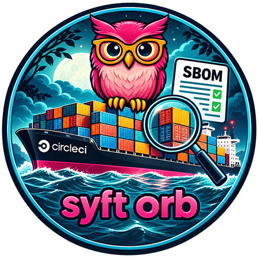
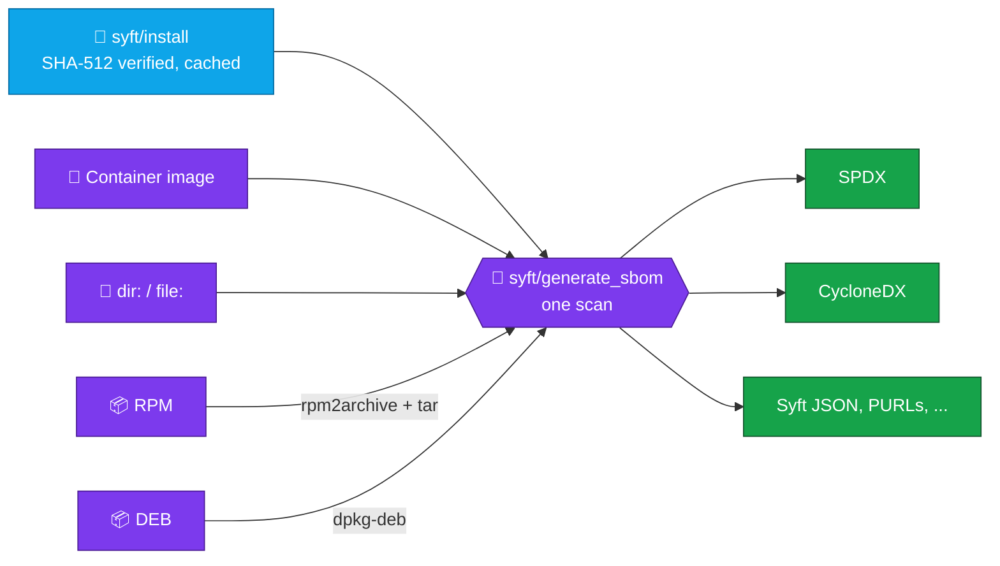

<div align="center">



# Syft Orb for CircleCI

### A Software Bill of Materials for every build, in a few lines of YAML.

Generate SPDX and CycloneDX SBOMs for container images, source trees, RPMs and DEBs with [Syft](https://github.com/anchore/syft),<br>
from one job in your workflow and no shell scripts to maintain.<br>
Strict SHA-512 verification by default · Cached installs · amd64 and arm64

[](https://circleci.com/gh/juburr/syft-orb)
[](https://circleci.com/developer/orbs/orb/juburr/syft-orb)
[](LICENSE)
[](https://discuss.circleci.com/c/ecosystem/orbs)


**[Quick Start](#-quick-start)** · **[Features](#-why-syft-orb)** · **[Sources](#-supported-sources)** · **[Recipes](#-recipes)** · **[Job Reference](#syftgenerate_sbom)** · **[Security](#-secure-by-design)** · **[Offline Builds](#-running-offline)**

<sub>An unofficial, community-maintained orb. [Contributions are welcome!](#-contributing)</sub>

</div>

<br>

## ✨ Why syft-orb?

<table>
<tr>
<td width="33%" valign="top">
📦 <b>Scan anything</b><br><br>
Container images, <code>dir:</code> source trees, single files, image archives, and RPM or DEB packages matched by wildcard. See <a href="#-supported-sources">Supported Sources</a>.
</td>
<td width="33%" valign="top">
🔬 <b>Looks inside packages</b><br><br>
RPMs and DEBs are unpacked before scanning, so the SBOM lists what actually ships inside them. RPMs over 4 GB work too.
</td>
<td width="33%" valign="top">
🧾 <b>One scan, many formats</b><br><br>
SPDX and CycloneDX out of the box, plus Syft JSON, GitHub JSON, PURLs and <a href="#-output-formats">more</a>, from a single Syft run. <code>ghcr.io/acme/app:1.0.0</code> becomes <code>sboms/app-1.0.0.spdx.json</code>, with no naming boilerplate.
</td>
</tr>
<tr>
<td width="33%" valign="top">
🧩 <b>Drop-in job</b><br><br>
The <code>syft/generate_sbom</code> job attaches your workspace, scans, logs, and persists SBOMs for downstream jobs in one step.
</td>
<td width="33%" valign="top">
🔐 <b>Verified, cached, multi-arch</b><br><br>
Syft downloads are verified against built-in SHA-512 checksums for 230+ releases, unknown versions <a href="#-checksum-verification">fail closed</a>, and the native amd64 or arm64 build is cached per version and architecture.
</td>
<td width="33%" valign="top">
🔒 <b>Security-team ready</b><br><br>
Every outbound host documented in <a href="#-network-access">Network Access</a>, a <a href="#-running-offline">disconnected-build</a> mode, and no update-check traffic from scans.
</td>
</tr>
</table>

### 🧩 The Orb vs. a Hand-Rolled Script

| | Scripting Syft yourself | With the orb |
| --- | --- | --- |
| **Installing Syft** | Pipe an install script into `sh`, or download a release and find and check its checksum yourself | `syft/install` checks a built-in SHA-512 for amd64 and arm64, fails closed on unknown versions, and caches the binary |
| **RPM and DEB packages** | Syft treats a package file as a single unit, so unpack it first, with `rpm2archive` rather than `rpm2cpio` and `cpio`, which fail on RPMs over 4 GB | Unpacked into a temporary directory before the scan, and removed when the step exits, whether the scan passes or fails |
| **Naming the files** | Work out a file name for each format and pass one `-o format=file` per format | Each format is written to a file named after the source, all from one scan |
| **Workflow wiring** | Attach the workspace, install, scan, then persist the SBOMs for later jobs | The `syft/generate_sbom` job does all of it |

## 🔄 How It Works



`syft/install` downloads Syft straight from its official GitHub releases, verifies its SHA-512 checksum in the default `strict` mode, caches it, and puts it on `PATH`. See [Checksum Verification](#-checksum-verification) for the other modes. `syft/generate_sbom` resolves the source: a package wildcard must match exactly one file, RPMs are unpacked with `rpm2archive` and `tar`, and DEBs with `dpkg-deb`. Syft then scans once and writes every format in `output_formats`, each to a file named after the source. The `syft/generate_sbom` job wraps both commands, attaching the workspace first and logging and persisting the SBOMs afterwards.

## 🚀 Quick Start

Add the orb and its `syft/generate_sbom` job to a workflow. Copy this into `.circleci/config.yml`:

```yaml
version: 2.1

orbs:
  syft: juburr/syft-orb@volatile

workflows:
  main:
    jobs:
      - syft/generate_sbom:
          source: "gcr.io/distroless/static:latest"
          attach_workspace: false # no upstream job to attach from
```

Push. The job installs a verified Syft, scans the image once, and writes both formats:

```text
sboms/
├── static-latest.cdx.json    # CycloneDX
└── static-latest.spdx.json   # SPDX
```

Each SBOM is previewed in the job log and persisted to the workspace, ready for the next job to sign, scan, or upload. Want different formats? Ask for several [output formats](#-output-formats) at once:

```yaml
- syft/generate_sbom:
    source: "gcr.io/distroless/static:latest"
    attach_workspace: false
    output_formats: "spdx-json,cyclonedx-json,syft-json"
```

> [!TIP]
> `@volatile` always resolves to the newest published release, which is handy for kicking the tyres. For production pipelines, pin a numeric version such as `@1.2.3`, or `@1.2` to pick up patch releases, so upgrades happen when you choose. The orb version badge above and the [Orb Registry](https://circleci.com/developer/orbs/orb/juburr/syft-orb) show the latest release. CircleCI does not accept `@latest`.

> [!TIP]
> Upgrading from the `syft/sbom` job? The next release renames it and some `log_sbom` parameters. See [Upgrading](#-upgrading).

## 🎯 Supported Sources

Point `source` at whatever you build:

| Source | Example `source` | What gets scanned |
| --- | --- | --- |
| Container image | `ghcr.io/acme/app:1.0.0` | The image pulled from its registry, with `scope` choosing which layers |
| Image archive | `docker-archive:app.tar` | A saved image, no registry pull (`oci-archive:` and `oci-dir:` work too) |
| Source directory | `dir:.` | Manifests and lockfiles such as `package.json`, `go.mod`, `Cargo.lock`, `requirements.txt` |
| Single file | `file:target/release/myapp` | One file, for example a `cargo auditable` binary |
| RPM package | `./rpms/myapp*.el9.x86_64.rpm` | The unpacked package contents, file by file |
| DEB package | `./debs/myapp_*_amd64.deb` | The unpacked package contents, file by file |

Package wildcards must match exactly one file, and the matched filename becomes the SBOM's base name. A `file:` prefix on an RPM or DEB path is dropped, so the package is still unpacked.

## 📊 Output Formats

List any of these in `output_formats`, comma-separated. Syft scans once and writes every format in the same run.

| Format | `output_formats` value | File suffix |
| --- | --- | --- |
| SPDX JSON | `spdx-json` | `.spdx.json` |
| SPDX tag-value | `spdx-tag-value` | `.spdx` |
| CycloneDX JSON | `cyclonedx-json` | `.cdx.json` |
| CycloneDX XML | `cyclonedx-xml` | `.cdx.xml` |
| Syft JSON | `syft-json` | `.syft.json` |
| Syft table / text | `syft-table` or `syft-text` (not both: they write the same file) | `.syft.txt` |
| GitHub dependency snapshot | `github-json` | `.github.json` |
| Package URLs | `purls` | `.purls.txt` |
| Go template (template path set in a `config` file) | `template` | `.txt` |

Each file is named after the source, plus the suffix above: an RPM or DEB's file name without `.rpm` or `.deb`, an image's name and tag joined by `-` (`ghcr.io/acme/app:1.0.0` becomes `app-1.0.0`), or the last component of a `dir:` or `file:` path. `dir:.` uses the working directory's name, so a default CircleCI job writes `project.spdx.json`.

## 🍳 Recipes

### Container Image SBOMs

Generate SBOMs for container images using the `generate_sbom` command. Output filenames are auto-generated based on the source, and you can produce multiple formats in a single scan:

```yaml
- syft/generate_sbom:
    source: ghcr.io/myorganization/customapp:1.0.0
    output_formats: "spdx-json,cyclonedx-json"
```

This produces `sboms/customapp-1.0.0.spdx.json` and `sboms/customapp-1.0.0.cdx.json`. Set `scope: all-layers` to catalog packages from every image layer rather than only the final filesystem.

### Source Code SBOMs

Scanning your repository captures dependencies declared in manifests and lockfiles that may never make it into compiled or bundled artifacts. Run the commands in your own job right after `checkout`:

```yaml
jobs:
  sbom-source:
    docker:
      - image: cimg/base:current-22.04
    steps:
      - checkout
      - syft/install
      - syft/generate_sbom:
          source: "dir:."
          output_formats: "spdx-json,cyclonedx-json"
      - store_artifacts:
          path: sboms
```

SBOMs for `dir:.` are named after the working directory, so a default CircleCI job writes `sboms/project.spdx.json` and `sboms/project.cdx.json`.

### Chaining with Your Build

The `syft/generate_sbom` job attaches the workspace before scanning and persists its output directory afterwards, so it slots between the jobs that build your artifacts and the jobs that ship them:

```yaml
workflows:
  build-and-ship:
    jobs:
      - build-rpms # persists rpms/ to the workspace
      - syft/generate_sbom:
          source: "rpms/myapp*.el9.x86_64.rpm"
          requires:
            - build-rpms
      - publish: # attach_workspace to find the SBOMs under sboms/
          requires:
            - syft/generate_sbom
```

The workspace is attached at the working directory by default. Set `attach_workspace_at` to attach it somewhere else, and adjust `source` to match; the SBOMs are still persisted relative to the working directory:

```yaml
- syft/generate_sbom:
    attach_workspace_at: build
    source: "build/rpms/myapp*.el9.x86_64.rpm"
```

### RPM SBOMs

For RPM packages, this orb enhances scanning by unpacking the RPM contents using `rpm2archive`. This approach produces more comprehensive results by scanning individual files rather than treating the RPM as a single unit, often revealing dependencies and vulnerabilities that would otherwise remain undetected.

```yaml
- syft/generate_sbom:
    source: ./rpms/customapp*.el9.x86_64.rpm
    output_formats: spdx-json
```

### DEB SBOMs

For Debian packages, the orb extracts contents using `dpkg-deb` before scanning, providing the same comprehensive analysis as RPM packages:

```yaml
- syft/generate_sbom:
    source: ./debs/myapp_*_amd64.deb
    output_formats: spdx-json
```

### Rust Binaries (cargo-auditable)

Binaries built with [`cargo auditable build`](https://github.com/rust-secure-code/cargo-auditable) embed their resolved crate list. Syft's `cargo-auditable-binary-cataloger` reads it with the default settings for `file:`, `dir:` and container image sources, so no extra parameters are needed:

```yaml
- syft/generate_sbom:
    source: file:target/release/myapp
    output_formats: "spdx-json,cyclonedx-json"
- syft/generate_sbom:
    source: ghcr.io/myorganization/myapp:1.0.0
```

A binary built with plain `cargo build` carries no dependency data, so its SBOM will not list any crates; scan the `Cargo.lock` with a `dir:` source instead.

### Limiting What Gets Scanned

Directory scans pick up everything under the scan root, including build output, vendored code and dependency trees. Use `exclude`, `config` and `select_catalogers` (on both the `generate_sbom` command and job) to keep an inventory focused:

```yaml
- syft/generate_sbom:
    source: "dir:."
    exclude: "./target/**,**/node_modules/**,./ref/**"
```

- `exclude` takes comma- or newline-separated globs, each passed to syft as `--exclude`. For `dir:` and `file:` sources and extracted RPM/DEB packages, patterns are relative to the scan root and must start with `./`, `*/` or `**/` (syft rejects anything else). For container images, patterns match absolute paths inside the image, such as `/usr/share/doc/**`. Brace alternations like `./{target,ref}/**` are kept intact.
- `config` points syft at a configuration file (`--config`) for anything the orb doesn't expose. Non-empty `exclude` and `select_catalogers` parameters replace the same keys in the file rather than merging with them. Without `config`, syft still loads a `.syft.yaml` from the working directory if one exists. RPM and DEB sources are scanned from a temporary extraction directory, so path-valued settings in the file (such as `format.template.path`) should be absolute when scanning packages.
- `select_catalogers` is passed to `--select-catalogers` and adjusts the default cataloger set for the source type: `+name` adds a cataloger, `-name` or `-tag` removes catalogers, and an unprefixed tag such as `rust` keeps only the default catalogers carrying that tag (syft rejects unprefixed cataloger names). For example, `-file` skips file metadata and `+sbom-cataloger` adds the SBOM cataloger. To replace the default set entirely, set `default-catalogers` in a config file. Run `syft cataloger list` to see names and tags.

Syft already ignores JavaScript lockfiles inside `node_modules`, but it still walks those trees and catalogs other ecosystems' manifests there (for example the `Cargo.lock` that native npm packages ship), so excluding them keeps the inventory accurate and the scan fast.

### Logging SBOMs

Print SBOMs to the job output for review or debugging. Files whose names end in `.json` are pretty-printed with `jq` and cut off after the first 100 lines; other files are printed in full:

```yaml
# Every SBOM in a directory.
# Template output (.txt) is skipped; log it with sbom_file instead.
- syft/log_sbom:
    sbom_dir: sboms

# Specific files: separate several with spaces; wildcards are allowed
- syft/log_sbom:
    sbom_file: sboms/static-latest.spdx.json sboms/*.cdx.json
```

### Running on Arm

To run the `syft/generate_sbom` job on arm64, pick an Arm resource class (the default `cimg/base` image is multi-arch):

```yaml
- syft/generate_sbom:
    source: "dir:."
    resource_class: arm.medium
```

## 🧱 Jobs

The [Orb Registry](https://circleci.com/developer/orbs/orb/juburr/syft-orb) lists every parameter with its current default, including the Syft version each orb release pins.

### `syft/generate_sbom`

Installs Syft, generates SBOMs in every requested format from a single scan, logs them, and persists them to the workspace, all in one job. It runs on the `cimg/base` Docker image, attaches the workspace first so it can reach artifacts from upstream jobs, and always installs Syft with caching on. It runs the [`install`](#syftinstall), [`generate_sbom`](#syftgenerate_sbom-1) and [`log_sbom`](#syftlog_sbom) commands, passing its parameters through to them.

| Parameter | Default | Description |
| --- | --- | --- |
| `source` | *required* | Package file path, container image, or directory to scan, as for the `generate_sbom` command. Package paths may use wildcards. See [Supported Sources](#-supported-sources). |
| `output_formats` | `cyclonedx-json,spdx-json` | Comma-separated [output formats](#-output-formats), all generated from a single scan. |
| `output_dir` | `sboms` | Directory for the SBOMs. |
| `syft_version` | `1.52.0` | Syft version to install. |
| `verify_checksums` | `strict` | `strict`, `known_versions` or `"false"`. See [Checksum Verification](#-checksum-verification). |
| `scope` | `squashed` | Image layers to catalog: `squashed`, `all-layers` or `deep-squashed`. |
| `enrich` | `all` | Package metadata enrichment from online sources: `none`, `all`, `golang`, `java`, `javascript`, `python` or `vcpkg`. |
| `exclude` | *(empty)* | Comma- or newline-separated globs to skip. See [Limiting What Gets Scanned](#limiting-what-gets-scanned). |
| `select_catalogers` | *(empty)* | Adjusts Syft's default cataloger set, such as `-file` or `+sbom-cataloger`. |
| `config` | *(empty)* | Path to a Syft configuration file, passed as `--config`. |
| `base_path` | *(empty)* | Overrides the base path for SBOM generation. Set automatically when empty. |
| `attach_workspace` | `true` | Attach the workspace before scanning, to reach upstream build artifacts. |
| `attach_workspace_at` | `.` | Directory to attach the workspace at, when `attach_workspace` is true. A relative path is resolved against the working directory. Persisting is not affected. |
| `persist_to_workspace` | `true` | Persist `output_dir` to the workspace afterwards, with the working directory as the workspace root. |
| `log_sboms` | `true` | Print the generated SBOMs to the job output, with JSON cut off after 100 lines. |
| `cimg_tag` | `current-22.04` | Tag of the `cimg/base` executor image. |
| `resource_class` | `medium` | `small`, `medium`, `medium+`, `large`, `xlarge`, `2xlarge`, `2xlarge+`, `arm.medium`, `arm.large`, `arm.xlarge` or `arm.2xlarge`. Use an `arm.*` class to run on arm64. |

## 🧰 Commands

### `syft/install`

Installs Syft for Linux on amd64 or arm64, matching the executor's CPU. In the default `strict` mode it verifies the SHA-512 checksum first and refuses versions it has no checksum for; see [Checksum Verification](#-checksum-verification) for the opt-outs. Run it before `generate_sbom`. Needs bash 4 or newer on the executor.

| Parameter | Default | Description |
| --- | --- | --- |
| `version` | `1.52.0` | Syft release to install; a leading `v` is ignored. Values that aren't a release version, such as `latest`, are rejected. |
| `verify_checksums` | `strict` | `strict`, `known_versions` or `"false"`. See [Checksum Verification](#-checksum-verification). |
| `caching` | `true` | Cache the Syft download, keyed by version, CPU architecture and home directory. Only verified downloads are cached, and they are verified again when restored. |
| `install_path` | `$HOME/bin` | Absolute path of the directory to install into, writable without root. Created if needed, and added to `PATH` for later steps when it isn't already on it. A leading `~/` is expanded. |

### `syft/generate_sbom`

Scans one source with Syft and writes one or more SBOM formats from that single scan, to files named after the source. Run `install` first. RPM sources need `rpm2archive` and `tar`, and DEB sources `dpkg-deb`; when one is missing, the command installs it with `apt-get`, `dnf` or `yum`, through `sudo` when the job doesn't run as root.

| Parameter | Default | Description |
| --- | --- | --- |
| `source` | *required* | Container image, `dir:` or `file:` path, image archive, RPM or DEB. Package paths may use wildcards. See [Supported Sources](#-supported-sources). |
| `output_formats` | `spdx-json` | Comma-separated [output formats](#-output-formats), all generated from a single scan. |
| `output_dir` | *(empty)* | Directory for the SBOMs; empty means `sboms/`. Filenames are derived from the source. |
| `scope` | `squashed` | Image layers to catalog: `squashed`, `all-layers` or `deep-squashed`. |
| `enrich` | `all` | Package metadata enrichment from online sources: `none`, `all`, `golang`, `java`, `javascript`, `python` or `vcpkg`. Syft on its own enables no enrichment; `none` is the [disconnected-build](#-running-offline) setting. |
| `exclude` | *(empty)* | Comma- or newline-separated globs to skip. See [Limiting What Gets Scanned](#limiting-what-gets-scanned). |
| `select_catalogers` | *(empty)* | Adjusts Syft's default cataloger set, such as `-file` or `+sbom-cataloger`. |
| `config` | *(empty)* | Path to a Syft configuration file, passed as `--config`. Relative paths are resolved against the working directory. |
| `base_path` | *(empty)* | Overrides the base path for SBOM generation (Syft's `--base-path`). When empty, the orb uses the extraction directory for RPM and DEB sources and `/` otherwise. |

### `syft/log_sbom`

Prints SBOMs to the job output for logging or debugging. A file whose name ends in `.json` is treated as JSON and cut off after the first 100 lines; other files are printed in full.

| Parameter | Default | Description |
| --- | --- | --- |
| `sbom_dir` | *(empty)* | Log the SBOMs in a directory, picked by the file suffixes `generate_sbom` writes. Template output (`.txt`) is skipped; use `sbom_file` for it. The step fails if the directory doesn't exist. |
| `sbom_file` | *(empty)* | Log specific SBOM files. Separate several with spaces; each may be a wildcard pattern, so paths cannot contain spaces. A file that doesn't exist is reported with a warning. |
| `pretty` | `true` | Boolean. Pretty-print JSON SBOMs with `jq`. |

Use either `sbom_dir` or `sbom_file`; when both are set, `sbom_dir` is used.

Environment variables are expanded in `install`'s `version` and `install_path`, in `generate_sbom`'s `source`, `output_formats`, `output_dir`, `exclude`, `select_catalogers`, `config` and `base_path`, and in `log_sbom`'s `sbom_dir` and `sbom_file`.

## 📦 Upgrading

The next release renames this job and these parameters:

| Old | New |
| --- | --- |
| `syft/sbom` job | `syft/generate_sbom`, the same name as the command it runs |
| `syft/sbom` job's `workspace_root` | `attach_workspace_at` |
| `log_sbom.sbom_path` | `sbom_file` |
| `log_sbom.sbom_format` | removed |

Behavior changes:

- `log_sbom` no longer takes the format of `sbom_file` from a parameter. Each file is treated as JSON when its name ends in `.json`, the same rule `sbom_dir` already used, so the files listed in one `sbom_file` no longer have to share a format.
- `ERROR:` and `WARN:` messages now go to stderr, and `log_sbom` prefixes a missing `sbom_file` entry with `WARN:` instead of `WARNING:`. If you capture a step's stdout and search it for these messages, capture stderr too (`2>&1`).

## 🔒 Secure by Design

- **Least Privilege**: `install` installs to a user-owned directory by default, with no `sudo`. The only `sudo` in this orb is `generate_sbom` installing a missing `rpm2archive`, `tar` or `dpkg-deb` for an RPM or DEB source when the job doesn't run as root; preinstall them in the executor image to avoid it.
- **Integrity**: SHA-512 checksum validation of downloaded binaries, on by default and failing closed: a Syft version this orb has no checksum for is refused, not installed unverified, and a binary that can't run on the executor never replaces an existing install. See [Checksum Verification](#-checksum-verification) for the `known_versions` and `"false"` opt-outs.
- **Provenance**: Installs directly from Syft's official [releases page](https://github.com/anchore/syft/releases/) on GitHub. No third-party websites, domains, or proxies are used.
- **Confidentiality**: All secrets and environment variables are handled in accordance with CircleCI's [security recommendations](https://circleci.com/docs/security-recommendations/) and [best practices](https://circleci.com/docs/orbs-best-practices/). RPM and DEB contents are unpacked into a temporary directory from `mktemp`, removed when the step exits, whether the scan passes or fails.
- **Privacy**: No usage data of any kind is collected or shipped back to the orb developer. Syft's start-up update check is turned off for scans run through `generate_sbom`. Enrichment, on by default as `enrich: all`, looks up package metadata in public package registries; `enrich: none` turns it off. See [Network Access](#-network-access).

> [!IMPORTANT]
> **Info for security teams:** see [Network Access](#-network-access) for the hosts to allow on locked-down or self-hosted runners, and [Running Offline](#-running-offline) for disconnected builds.

## 💻 Supported Platforms

Linux executors on `x86_64` (amd64) and `aarch64`/`arm64` (arm64), including CircleCI [Arm resource classes](https://circleci.com/docs/using-arm/). The `install` command picks the Syft release asset for the architecture reported by `uname -m` and, in the default `strict` mode, verifies it against that architecture's SHA-512 checksum. Any other operating system or architecture fails the install rather than installing a binary that can't run.

| `uname -m` | Release asset installed |
| --- | --- |
| `x86_64` | `syft_<version>_linux_amd64.tar.gz` |
| `aarch64` or `arm64` | `syft_<version>_linux_arm64.tar.gz` |

Linux arm64 builds exist from Syft 0.28.0 onward. The `syft/generate_sbom` job runs on `cimg/base`, which is multi-arch, so an `arm.*` `resource_class` is all it takes to run it on arm64 (see [Running on Arm](#running-on-arm)). `install` and `generate_sbom` need bash 4 or newer, and `install` also needs `mktemp`, `tar`, `gzip`, and `curl` or `wget`, plus `sha512sum` when it verifies. `cimg/base` ships `dpkg-deb` but not `rpm`, so an RPM source on it installs `rpm` first.

The download cache is keyed by Syft version, executor architecture and home directory, so amd64 and arm64 jobs never share a cached binary. On executors whose `PATH` doesn't already include `install_path` (for example, machine executors), `install` adds it for later steps through `BASH_ENV`.

## 🔐 Checksum Verification

The `install` command checks the Syft binary from the downloaded release against a SHA-512 lookup table built into the orb, with one entry per Syft version and architecture. The `verify_checksums` parameter, on the `install` command and the `syft/generate_sbom` job, controls what happens:

| Value | Version in the orb's table | Version not in the table |
| --- | --- | --- |
| `strict` (default) | ✅ Verified; install fails on mismatch | ⛔ Install fails before anything is downloaded |
| `known_versions` | ✅ Verified; install fails on mismatch | ⚠️ Installed **unverified**, with a warning |
| `"false"` | ⚠️ Not verified | ⚠️ Installed **unverified** (not recommended) |

The table covers the default `version` and earlier releases, back to Syft 0.1.0 on amd64 and 0.28.0 on arm64. If you pin a Syft release newer than this orb, `strict` fails until the orb is upgraded. Upgrade the orb (or [open a PR](#-contributing) adding the checksum) rather than opting out.

> [!WARNING]
> **Upgrading to v0.10.0:** the default changed from `known_versions` to `strict`. If you pin a Syft `version` that is newer than this orb release knows about, the install now fails instead of installing an unverified binary. Upgrade the orb to a release that includes that version, or opt out explicitly:
>
> ```yaml
> - syft/install:
>     version: "1.99.0"
>     verify_checksums: known_versions
> ```

## 🌐 Network Access

Hosts below were determined from the Syft v1.52.0 source (the orb's default version). The default Syft, GitHub, registry and package-ecosystem endpoints listed use outbound HTTPS (port 443). Endpoints you configure yourself use whatever scheme and port they specify: a custom `GOPROXY` or Syft config URL, git registries declared in `vcpkg-configuration.json` (which may use SSH, e.g. `git@host:org/repo`), and distribution package mirrors (see below, often plain HTTP).

**Installing Syft** (`syft/install`, also run by the `syft/generate_sbom` job). Skipped on a CircleCI cache hit.

| Host | Needed by | Purpose |
| --- | --- | --- |
| `github.com` | `install` | Syft release download (`/anchore/syft/releases/download/...`) |
| `release-assets.githubusercontent.com` | `install` | Where GitHub currently redirects release downloads |
| `objects.githubusercontent.com` | `install` | GitHub's previous redirect target for release downloads; allow it as well |

**Enrichment** (`enrich` other than `none`). Note that this orb defaults to `enrich: all`, whereas Syft on its own enables no enrichment. Requests are only made for packages that the matching catalogers actually find.

| `enrich` | Hosts contacted | Override in a Syft `config` file |
| --- | --- | --- |
| `golang` | `proxy.golang.org` (or `$GOPROXY`), which may redirect module downloads to `storage.googleapis.com`. For modules the proxy cannot serve, and for modules matching `GOPRIVATE`/`GONOPROXY`, Syft falls back to `direct`: a shallow git clone over HTTPS from the module path's host (e.g. `github.com`), so any VCS host may be contacted. | `golang.proxy`, `golang.no-proxy` |
| `java` | `repo1.maven.org` (Maven Central) | `java.maven-url` |
| `javascript` | `registry.npmjs.org` | `javascript.npm-base-url` |
| `python` | `pypi.org` | `python.pypi-base-url` |
| `vcpkg` | `github.com` (git clone of `microsoft/vcpkg`), plus any git registries declared in the project's `vcpkg-configuration.json` | `cpp.vcpkg-allow-git-clone: false` disables cloning |
| `all` | All of the above | |

**Scanning, independent of `enrich`:**

- Container images referenced by name are pulled from their registry, plus that registry's auth and blob hosts. For Docker Hub (including unqualified names such as `ubuntu:latest`) that is `registry-1.docker.io`, `auth.docker.io` and its layer CDNs `production.cloudfront.docker.com` and `production.cloudflare.docker.com`. Loading `docker-archive:`, `oci-archive:` and `oci-dir:` sources needs no network, but the enrichment above still applies to the packages found inside them.
- For RPM and DEB sources, if `rpm2archive` or `tar` (RPM) or `dpkg-deb` (DEB) is missing, the orb installs it with `apt-get`, `dnf` or `yum`, which contacts the distribution mirrors configured in the executor image, using their configured scheme (Ubuntu images commonly use `http://archive.ubuntu.com`). `cimg/base` ships `dpkg-deb` but not `rpm`.
- If a Go toolchain is on `PATH` and a `go.mod` is in scope, Syft runs `go list` for every `enrich` value except `none` (including non-Go values such as `javascript`), or whenever a config file sets `golang.use-packages-lib: true`. It can download missing modules through `GOPROXY` (`proxy.golang.org`, possibly redirecting to `storage.googleapis.com`), fall back to the module's own VCS host (any host, e.g. `github.com`) for private modules or ones the proxy cannot serve, because the default `GOPROXY` ends in `direct`, and check hashes missing from `go.sum` against `GOSUMDB` (`sum.golang.org`). With other `enrich` values, set `SYFT_GOLANG_USE_PACKAGES_LIB=false` to stop Syft from running `go list`. `cimg/base` has no Go toolchain.
- Syft's start-up update check (`toolbox-data.anchore.io`) is disabled for scans run through the `syft/generate_sbom` command and job, which set `SYFT_CHECK_FOR_APP_UPDATE=false` since the orb pins the version (a value you set yourself takes precedence). If you run `syft` directly after `syft/install`, set `SYFT_CHECK_FOR_APP_UPDATE=false` in your job to avoid the request.

`install` caches by default (`caching: true`, and always in the `syft/generate_sbom` job), so it also uses CircleCI's cache storage. On CircleCI Cloud, the [runner FAQ](https://circleci.com/docs/guides/execution-runner/runner-faqs/#what-connectivity-is-required) lists what a runner needs to reach; on CircleCI Server, it is your installation's object storage.

## 📡 Running Offline

`enrich: none` is the disconnected-build setting: the orb passes `--enrich none` to Syft, which also overrides an `enrich` list in a config file or `.syft.yaml`. Per-ecosystem network settings in a config file (for example `javascript.search-remote-licenses: true`, `java.use-network: true` or `golang.use-packages-lib: true`) or in the equivalent environment variables (`SYFT_JAVASCRIPT_SEARCH_REMOTE_LICENSES`, `SYFT_JAVA_USE_NETWORK`, `SYFT_GOLANG_USE_PACKAGES_LIB`, ...) still take precedence over `--enrich`, so leave them unset or set them to `false`. For a build with no egress at all, also:

- provide `syft` in the executor image and use the `syft/generate_sbom` command in your own job instead of `syft/install` or the `syft/generate_sbom` job;
- scan local sources only (`dir:`, `file:`, `docker-archive:`, `oci-archive:`, `oci-dir:`, or an image already in the local daemon via `docker:`);
- for RPM or DEB sources, preinstall `rpm2archive` (from the `rpm` package), `tar` and `gzip`, or `dpkg-deb`, in the executor image, since the orb otherwise tries to install them from the distribution mirrors.

## 🤝 Contributing

This is an unofficial, community-maintained orb, and contributions are welcome! Bug reports, feature ideas and pull requests all help.

- **Found a bug or have an idea?** [Open an issue](https://github.com/juburr/syft-orb/issues) or a [pull request](https://github.com/juburr/syft-orb/pulls).
- **Need a newer Syft release?** Generate its checksums with `src/scripts/install_hash.sh -v <version>`, paste them into the `sha512sums` table in [`src/scripts/install.sh`](src/scripts/install.sh), and open a pull request. The script prints entries for linux amd64 and arm64 after checking each asset against `syft_<version>_checksums.txt`, the SHA-256 list Syft publishes with each release, and needs `cosign` to verify that list's keyless Sigstore signature for releases from 0.104.0 on.
- **Before opening a pull request**, run the checks CI runs, with the [CircleCI CLI](https://circleci.com/docs/local-cli/) and [ShellCheck](https://www.shellcheck.net/). The tests run offline, with stand-ins for `syft` and the downloads they need; `circleci orb validate` checks the packed orb against the CircleCI API, so it needs network access. CI also runs integration tests on amd64 and arm64.

  ```bash
  yamllint .
  shellcheck src/scripts/*.sh tests/*.sh
  for t in tests/*_test.sh; do bash "$t" || break; done
  circleci orb pack src/ > orb.yml && circleci orb validate orb.yml
  ```

## 🎨 Logo

Need the logo for a slide deck, blog post, or internal developer portal? PNGs with transparent backgrounds are in [`assets/logos`](assets/logos): [64](assets/logos/syft-orb-64px.png) · [128](assets/logos/syft-orb-128px.png) · [256](assets/logos/syft-orb-256px.png) · [512](assets/logos/syft-orb-512px.png) · [1024](assets/logos/syft-orb-1024px.png) px

## 📜 License

[MIT](LICENSE) © 2024-2026 Justin Burr

[Syft](https://github.com/anchore/syft) is developed by [Anchore](https://anchore.com).

<br>

<div align="center">
  
  <br>
  <sub>Know what ships in every build. If this orb helps your team, a ⭐ helps others find it.</sub>
  <br>
  <sub><a href="#syft-orb-for-circleci">Back to top ↑</a></sub>
</div>
